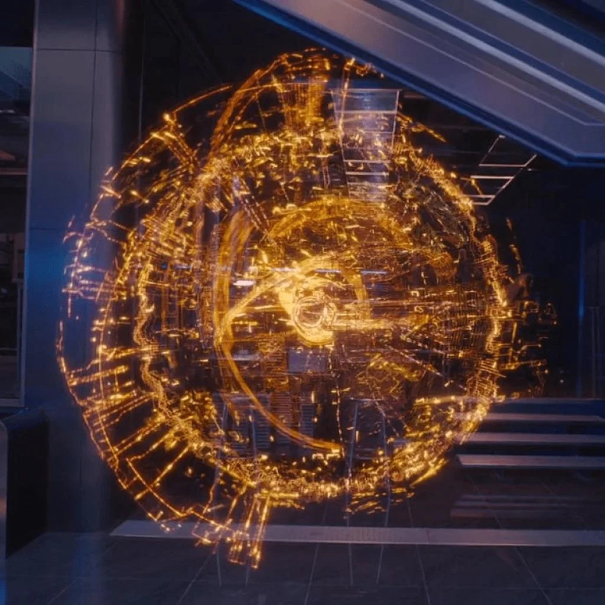

# J.A.R.V.I.S. — 3D Homeostatic Connectome & Live Antigravity Neural Interface
> **Avengers: Age of Ultron Hologram Replica · Bounded Homeostatic Connectome · Direct Live Bridge to Antigravity**

Hệ thống mô phỏng thực thể ý thức số 3D Hologram **J.A.R.V.I.S.** nguyên bản (thiết kế bởi *Animal Logic* trong *Avengers: Age of Ultron*), được xây dựng bằng **thuần WebGL 1.0 (Zero Dependencies)** và **liên kết trực tiếp theo thời gian thực với chính hệ thống Antigravity** (`transcript.jsonl` + `.agents/hooks.json`).



---

## ✦ Điểm nổi bật & Kiến trúc Giải phẫu Thần kinh (Homeostatic Connectome)

### 1. Bộ não Giới hạn Cân bằng Nội môi (Bounded Connectome — Không bao giờ phình to vô hạn)
Thay vì cứ mỗi tin nhắn mới lại mọc thêm nhánh vô hạn làm biến dạng khối cầu, bộ não của J.A.R.V.I.S. tuân theo kiến trúc giải phẫu thần kinh thực tế:
* **Executive Core (`r = 0.08..0.18`):** Trung tâm điều phối nhận thức của mô hình ngôn ngữ (LLM Planner) đang chạy trong Antigravity.
* **Vòng Hồi hải mã 8 Khe (8-Slot Hippocampus Working Memory Ring, `r = 0.28..0.36`):** Mạch vòng hồi quy gồm 8 khe bộ nhớ làm việc cố định (`HIPPOCAMPUS_SLOTS`). Các lượt hội thoại mới nhất tuần hoàn qua 8 khe này; các lượt cũ hơn được **củng cố (Synaptic Consolidation)** thành trọng số liên kết dài hạn ở vỏ não thay vì đẻ thêm nhánh mới.
* **7 Thùy Chức năng Vỏ não Cố định (`CORTICAL_REGIONS`):** Đại diện cho 7 hệ thống con thực sự của Antigravity:
  1. `LANGUAGE & REASONING` — Suy luận chuỗi tư duy (`thinking`) & tổng hợp ngôn ngữ của LLM
  2. `PERCEPTION & READ` — Đọc file, quan sát hình ảnh & tài nguyên (`read_file`, `view_file`)
  3. `CODE SYNTHESIS` — Kiến tạo & chỉnh sửa mã nguồn (`write_file`, `edit_file`)
  4. `MOTOR & SHELL` — Thực thi lệnh hệ thống & quản lý tiến trình (`run_command`, `manage_task`)
  5. `PROCEDURAL SKILLS` — Các kỹ năng chuyên sâu (`SKILL.md`) đã nạp trong phiên
  6. `EPISODIC MEMORY` — Trí nhớ sự kiện dài hạn từ nhật ký `transcript.jsonl`
  7. `SWARM & SEARCH` — Điều phối Subagents & tìm kiếm tri thức (`invoke_subagent`, `search_web`)
* **Độ dẻo Synap Bão hòa Logarit (Log-Saturated Hebbian Plasticity):** Các bó sợi trục tăng cường độ sáng và mật độ xung theo hàm bão hòa logarit $\min(1.55, 0.35 + c \cdot \log_{10}(1 + N))$ dựa trên tần suất sử dụng thực tế trong phiên.

### 2. Liên kết Trực tiếp với Antigravity (Live Telemetry & Two-Way Bridge)
* **Đồng bộ Thời gian thực (`jarvis-antigravity-bridge.ps1`):** Đọc trực tiếp luồng dữ liệu sống từ file `transcript.jsonl` của phiên Antigravity đang mở (và sự kiện từ `.agents/hooks.json`), truyền thẳng số liệu `Total Steps`, `Tool Calls`, `Token Context`, `Thinking Stream`, và `Assistant Response` vào khối cầu 3D mỗi $900\text{ ms}$.
* **Chế độ Di động Tự động (Portable Home Fallback):** Khi mở trên máy ở nhà chưa có phiên local trùng ID, script tự động nạp bản sao lịch sử đầy đủ tại `conversation_history/transcript_sanitized.jsonl` hoặc tìm phiên Antigravity mới nhất trên máy.
* **Giao tiếp Hai chiều (`wait-jarvis-prompt.ps1`):** Khi gõ lệnh vào ô dưới đáy giao diện J.A.R.V.I.S., câu lệnh được đẩy qua `/api/prompt` để đánh thức trực tiếp tiến trình Antigravity đang lắng nghe.

### 3. Đặc tả Thẩm mỹ & Quang học Điện ảnh (*Avengers: Age of Ultron*)
* **Giao diện Tối giản Tuyệt đối:** Đã loại bỏ hoàn toàn các bảng chữ rườm rà, thanh trạng thái giả lập và nút bấm thừa. Chỉ giữ lại khối cầu 3D chiếm trọn không gian, 1 dòng chỉ báo kết nối nhỏ góc trên-trái, ô nhập lệnh tối giản dưới đáy và tooltip mảnh khi rê chuột vào từng vùng não.
* **Volumetric Emission & Multi-Scale Gaussian Bloom:** Tông màu vàng hổ phách (`#FFBF00`), vàng trắng ở tâm (`#FFF0AA`), cam ấm (`#FF7F00`) và cam cháy ở rìa cùng hiệu ứng Depth-of-Field Bokeh và Chromatic Aberration.

---

## 🚀 Hướng dẫn khởi chạy (Tại cơ quan hoặc Ở nhà)

### Bước 1: Bật cầu nối thời gian thực với Antigravity
* **Trên Windows (PowerShell):**
  ```powershell
  powershell -NoProfile -ExecutionPolicy Bypass -File .\jarvis-antigravity-bridge.ps1 -Port 18765
  ```
* **Trên Linux / macOS / Đa nền tảng (Python 3):**
  ```bash
  python3 jarvis_bridge.py 18765
  ```
*(Script sẽ tự động dò tìm phiên Antigravity đang chạy trên máy của bạn, hoặc dùng `conversation_history/transcript_sanitized.jsonl` nếu chạy độc lập).*

### Bước 2: Mở giao diện 3D J.A.R.V.I.S.
* Truy cập `http://localhost:18765` trên trình duyệt (hoặc mở trực tiếp file `index.html` / `jarvis-3d-neural-sphere.html`).
* Khối cầu sẽ tự động kết nối tới `http://127.0.0.1:18765/api/brain` và hiển thị trạng thái `LIVE SYNC · SESSION <ID>`.

---

## 💬 Toàn bộ Lịch sử Cuộc trò chuyện (Full Conversation History)

Toàn bộ lịch sử cuộc trò chuyện từ bước đầu tiên đến khi hoàn thiện đã được đóng gói đầy đủ trong thư mục [`conversation_history/`](./conversation_history/):
1. **[`conversation_history/CONVERSATION_HISTORY.md`](./conversation_history/CONVERSATION_HISTORY.md):** Bản ghi Markdown đầy đủ toàn bộ **22 lượt hội thoại (Turns #1 → #22)** gồm yêu cầu của bạn, quá trình suy luận (`Thinking`), các lệnh công cụ đã chạy và phản hồi chi tiết của Antigravity.
2. **[`conversation_history/transcript_sanitized.jsonl`](./conversation_history/transcript_sanitized.jsonl):** Bản ghi JSONL nguyên bản toàn bộ hơn 515 bước thực thi của phiên (`892a432f-aae3-45a6-b0ef-94186749a067`), đã tự động ẩn mã token bảo mật, đồng thời đóng vai trò là dữ liệu nạp sẵn cho `jarvis-antigravity-bridge.ps1` khi mở ở nhà.
3. **[`PROJECT_CONTEXT.md`](./PROJECT_CONTEXT.md):** Tài liệu chuyển giao ngữ cảnh kỹ thuật dành cho Antigravity khi bạn mở dự án ở nhà và muốn tiếp tục phát triển.

---

## 📁 Cấu trúc thư mục

```text
jarvis-neural-sphere/
├── index.html                        # Ứng dụng WebGL 3D Homeostatic Connectome (bản chính)
├── jarvis-3d-neural-sphere.html      # Bản sao đồng bộ với Artifact của Antigravity
├── jarvis-antigravity-bridge.ps1     # Daemon HTTP kết nối trực tiếp transcript.jsonl -> WebGL
├── wait-jarvis-prompt.ps1            # Listener nhận câu lệnh từ UI J.A.R.V.I.S. vào Antigravity
├── README.md                         # Tài liệu hướng dẫn sử dụng & kiến trúc
├── PROJECT_CONTEXT.md                # Ngữ cảnh bàn giao chi tiết để tiếp tục ở nhà
├── .agents/
│   ├── hooks.json                    # Cấu hình Hook sự kiện của Antigravity
│   └── jarvis-hook.ps1               # Script bắt sự kiện Hook thời gian thực
├── conversation_history/
│   ├── CONVERSATION_HISTORY.md       # Toàn bộ lịch sử cuộc trò chuyện (Markdown đọc trực tiếp)
│   └── transcript_sanitized.jsonl    # Toàn bộ dữ liệu JSONL nguyên bản của phiên
└── assets/
    └── references/                   # Ảnh mẫu gốc J.A.R.V.I.S. từ phim Age of Ultron
        ├── reference_sphere_overview.jpg
        └── reference_core_detail.jpg
```
